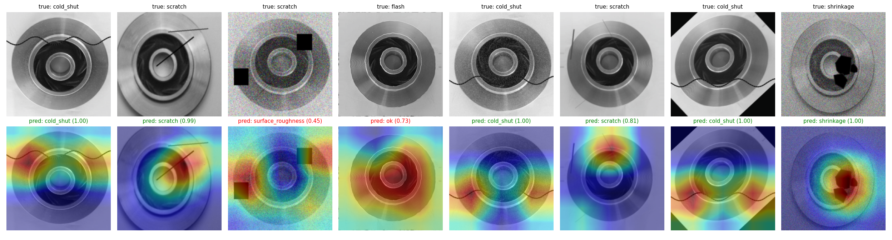

# 🏭 Multi-Stage Visual Quality System (CNN + GAN)

### Industrial Casting Defect Classification | Deep Learning Capstone Project

<p align="center">
  
  
  
  
  
  
</p>

---

## 📌 Project Overview

Industrial casting defects can affect product quality, structural reliability and manufacturing safety. Traditional manual inspection can be time-consuming and inconsistent, making automated visual inspection an important application of computer vision.

This project develops a **Multi-Stage Visual Quality System** using Convolutional Neural Networks (CNNs), transfer learning and Generative Adversarial Networks (GANs) to classify industrial casting defects across 12 categories.

The system investigates whether synthetic minority-class images generated using DCGAN can improve defect classification, particularly for the underrepresented `dent` class.

Four classification approaches are evaluated, followed by Grad-CAM-based visual explainability.

## 🎯 Project Objectives

- Develop a CNN-based industrial casting defect classification system.
- Compare a CNN trained from scratch with pretrained ResNet18.
- Investigate class-weighted learning for minority-class recognition.
- Implement DCGAN to generate synthetic minority-class images.
- Evaluate GAN-based data augmentation against conventional class weighting.
- Perform multi-seed experiments for more reliable validation comparisons.
- Use Grad-CAM to interpret model predictions.
- Evaluate generalization using a real, held-out test dataset.

---

## 🗂️ Dataset

**Dataset:** Casting Product Defect Detection

**Source:** [Kaggle – Casting Defect Detection](https://www.kaggle.com/datasets/simmoshaikh/casting-defect-detection)

The dataset contains 1,200 images distributed across 12 classes, with 100 images per class.

### Classification Categories

| Category | Description |
|---|---|
| cold_shut | Incomplete fusion between metal flows |
| crack | Visible cracks in the casting |
| dent | Indented or deformed surface |
| flash | Excess material along casting edges |
| inclusion | Foreign material within the casting |
| mixed_defects | Multiple defect patterns |
| ok | Defect-free casting |
| pinhole | Small surface holes |
| porosity | Pores or cavities |
| scratch | Surface scratches |
| shrinkage | Defects caused by metal contraction |
| surface_roughness | Irregular surface texture |

### Dataset Split

The original dataset is balanced. To investigate minority-class learning, the `dent` class was deliberately reduced in the training split.

| Dataset | Images |
|---|---:|
| Original dataset | 1,200 |
| Training (after downsampling) | 805 |
| Validation | 180 |
| Testing | 180 |
| Synthetic images per seed | 500 |

The training split retains 35 real `dent` images instead of 70. Validation and test sets remain unchanged.

**Important:** Synthetic images are added exclusively to the training data. The final test set contains only real images.

---

## 🧠 System Architecture

The project evaluates four classification models and one generative model.

### 1. CNN from Scratch

A custom CNN architecture consisting of four convolutional blocks with:

- Convolutional layers
- Batch Normalization
- ReLU activation
- Max Pooling
- Global Average Pooling
- Dropout
- Fully connected classification layer

This model serves as the from-scratch baseline.

### 2. ResNet18 – Transfer Learning

A pretrained ResNet18 model using ImageNet weights.

- Replaces the original classification layer with a 12-class output layer.
- Freezes the backbone for the first three epochs.
- Fine-tunes the complete network afterwards.

### 3. Class-Weighted ResNet18

Uses weighted cross-entropy loss to give additional importance to the minority `dent` class.

This provides a conventional imbalance-handling baseline.

### 4. DCGAN – Synthetic Image Generation

A Deep Convolutional Generative Adversarial Network (DCGAN) generates synthetic images of the minority `dent` class.

**Generator:**
- Takes a 100-dimensional random noise vector.
- Uses transposed convolutional layers.
- Produces 64 × 64 RGB images.

**Discriminator:**
- Uses strided convolutional layers.
- Learns to distinguish real images from generated images.

Training configuration:
- 300 epochs.
- Adam optimizer.
- Learning rate: 0.0002.
- Batch size: 32.
- 500 synthetic images generated per seed.

### 5. GAN-Augmented ResNet18

The generated synthetic images are combined with real training images and used to train ResNet18.

The objective is to investigate whether GAN-based augmentation improves minority-class recall on unseen real images.

---

## 🔬 Experimental Methodology

Four experiments were conducted:

| Experiment | Model | Purpose |
|---|---|---|
| 1 | CNN from Scratch | Establish a baseline |
| 2 | ResNet18 | Evaluate transfer learning |
| 3 | Class-Weighted ResNet18 | Handle class imbalance |
| 4 | GAN-Augmented ResNet18 | Investigate synthetic data augmentation |

### Multi-Seed Evaluation

Experiments were repeated using three random seeds:

`42, 101, 2023`

Validation performance is reported as mean and standard deviation across the three seeds.

The final held-out test evaluation was performed on the Seed 42 test split.

### Training Configuration

| Parameter | Configuration |
|---|---|
| Image size | 224 × 224 |
| Batch size | 32 |
| Maximum classifier epochs | 20 |
| Optimizer | AdamW |
| Learning rate | 0.001 |
| Weight decay | 0.0001 |
| Learning rate scheduler | Cosine Annealing |
| Early stopping patience | 5 |
| Transfer learning freeze period | 3 epochs |
| GAN epochs | 300 |
| Synthetic images | 500 per seed |
| Random seeds | 42, 101, 2023 |
| Framework | PyTorch |
| Environment | Google Colab with CUDA GPU |

---

## 📊 Experimental Results

### Multi-Seed Validation Results

Mean ± standard deviation across seeds 42, 101 and 2023.

| Model | Macro F1 | Minority Recall | Accuracy |
|---|---:|---:|---:|
| CNN from Scratch | 0.296 ± 0.044 | 0.000 ± 0.000 | 0.363 ± 0.037 |
| ResNet18 Baseline | 0.845 ± 0.004 | 0.733 ± 0.067 | 0.846 ± 0.003 |
| Class-Weighted ResNet18 | 0.839 ± 0.013 | 0.756 ± 0.039 | 0.844 ± 0.015 |
| GAN-Augmented ResNet18 | 0.836 ± 0.041 | **0.822 ± 0.102** | 0.841 ± 0.037 |

The GAN-augmented model achieved the highest mean minority-class recall on validation data. However, its performance was more variable across seeds.

### Final Held-Out Test Results

Evaluation on 180 real images from the Seed 42 test split.

| Model | Accuracy | Macro F1 | Dent Recall |
|---|---:|---:|---:|
| CNN from Scratch | 25.56% | 0.1813 | 0.0000 |
| ResNet18 Baseline | 80.56% | 0.8009 | 0.8667 |
| Class-Weighted ResNet18 | 80.56% | 0.8010 | **0.9333** |
| GAN-Augmented ResNet18 | 80.00% | 0.7977 | 0.8000 |

### Key Findings

- ResNet18 transfer learning significantly outperformed the custom CNN trained from scratch.
- Class weighting improved minority-class recall on the held-out test set.
- GAN augmentation achieved the highest average minority recall during multi-seed validation.
- GAN augmentation did not improve minority recall on the final held-out test set.
- Class-weighted ResNet18 achieved the highest test minority recall of 93.33%.

**Conclusion:** GAN-based augmentation showed promising validation results, but did not demonstrate a reliable improvement on the held-out test set. In this experiment, class weighting was a simpler and more effective approach for minority-class recall.

---

## 🔍 Explainability – Grad-CAM

Grad-CAM (Gradient-weighted Class Activation Mapping) is used to understand which image regions influence the model's predictions.

The visualization highlights important image regions using heatmaps.

### Grad-CAM Visualization



*Grad-CAM visualizations of eight test images using the GAN-augmented ResNet18 model.*

The heatmaps show that the model often focuses on defect regions or their surrounding areas. Some incorrect predictions produce diffuse attention maps, indicating that the model may rely on broader contextual patterns rather than clearly localized defects.

Grad-CAM provides an additional interpretability layer for evaluating model behaviour.

---

## ⚠️ Limitations

- The dataset contains only 1,200 images.
- Minority-class imbalance was artificially introduced.
- The GAN was trained using only 35 real minority-class images per seed.
- Some generated images were blurry and showed limited visual diversity.
- Possible partial mode collapse was observed through visual inspection.
- The final held-out test evaluation used only one seed.
- Certain classes, particularly `flash` and `ok`, showed notable confusion.
- Grad-CAM explanations were qualitative and based on a small sample.

These limitations indicate that further investigation is required before considering the system for real-world industrial inspection.

---

## 🛠️ Technology Stack

| Category | Technologies |
|---|---|
| Programming Language | Python |
| Deep Learning | PyTorch |
| Computer Vision | Torchvision, PIL |
| Model Architectures | CNN, ResNet18, DCGAN |
| Data Processing | NumPy, Pandas |
| Evaluation | Scikit-learn |
| Visualization | Matplotlib |
| Explainability | Grad-CAM |
| Development Environment | Google Colab |
| Hardware Acceleration | CUDA GPU |

---

## 🚀 How to Run the Project

### 1. Clone the Repository

```bash
git clone https://github.com/adityakumarsingh01/Multi-Stage-Visual-Quality-System-CNN-and-GAN.git
cd Multi-Stage-Visual-Quality-System-CNN-and-GAN
```

### 2. Install Dependencies

```bash
pip install torch torchvision numpy pandas scikit-learn matplotlib pillow
```

### 3. Download the Dataset

Download the dataset from:

[Casting Product Defect Detection – Kaggle](https://www.kaggle.com/datasets/simmoshaikh/casting-defect-detection)

Extract the dataset and arrange it into class-specific folders.

### 4. Open the Notebook

The recommended execution environment is Google Colab.

[Open Project Notebook](https://colab.research.google.com/drive/1AVsHxIerjKPUTQaSzSJ3z9X71OTE_Lx_?usp=sharing)

Mount Google Drive, configure the dataset path and execute the notebook following its execution guide.

**Note:** Full GAN and multi-seed training requires GPU acceleration and may take considerable time.

---

## 📁 Project Structure

```text
Multi-Stage-Visual-Quality-System-CNN and GAN/
│
├── Notebook/
│   └── CSD402_Capstone_Option_A_CNN_GAN.ipynb
│
├── Trained_Models/
│   ├── scratch_seed_42.pt
│   ├── resnet18_seed_42.pt
│   ├── resnet18_cw_seed_42.pt
│   └── resnet18_gan_seed_42.pt
│
├── GAN_Artifacts/
│   ├── GAN_Checkpoints/
│   └── GAN_History/
│
├── Experiment_Results/
│   ├── multi_seed_results.csv
│   ├── multi_seed_results_raw.csv
│   └── test_results.csv
│
├── Explainability/
│   └── gradcam.png
│
├── Report/
│   ├── Aditya_Kumar_Singh_Capstone Project_Report.pdf
│   └── Aditya_Kumar_Singh_Capstone Project_Report.docx
│
└── README.md
└── .gitignore
```

*The structure above describes the organized project artifacts. Include the corresponding folders and files in your repository when uploading them.*

---

## 🔮 Future Improvements

- Increase the size and diversity of the casting dataset.
- Explore conditional GAN architectures.
- Investigate higher-resolution synthetic image generation.
- Evaluate generated image quality using FID or other suitable metrics.
- Experiment with EfficientNet and other pretrained backbones.
- Perform independent test evaluation across all random seeds.
- Investigate class-specific decision thresholds.
- Improve performance on visually similar defect categories.

---

## 📚 References

1. Kaggle – [Casting Defect Detection Dataset](https://www.kaggle.com/datasets/simmoshaikh/casting-defect-detection).
2. Paszke et al. (2019). *PyTorch: An Imperative Style, High-Performance Deep Learning Library.*
3. He et al. (2016). *Deep Residual Learning for Image Recognition.* CVPR.
4. Deng et al. (2009). *ImageNet: A Large-Scale Hierarchical Image Database.*
5. Goodfellow et al. (2014). *Generative Adversarial Nets.*
6. Radford, Metz and Chintala (2016). *Unsupervised Representation Learning with Deep Convolutional Generative Adversarial Networks.*
7. Selvaraju et al. (2017). *Grad-CAM: Visual Explanations from Deep Networks via Gradient-Based Localization.*
8. Loshchilov and Hutter (2019). *Decoupled Weight Decay Regularization.*

---

## 👨‍💻 Author

**Aditya Kumar Singh**

B.Tech. (Hons.) (CSE - Data Science and Data Engineering)  
Lovely Professional University

**Course:** Deep Learning  
**Academic Task:** Capstone Project  
**Project:** Multi-Stage Visual Quality System (CNN + GAN)

---

## 📄 License

This project was developed for academic and educational purposes as part of the CSD402 Deep Learning Capstone Project.

Dataset usage is subject to the original dataset's license and terms.
